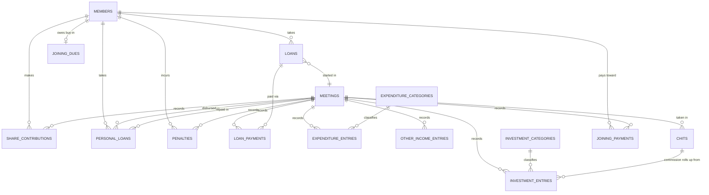

# Masiriyamman Mandram — Loan & Savings Ledger App

This documents the **as-built** application (not the original plan — see "Changes from the
original plan" at the bottom for what shifted during implementation).

Stack: **Flask (Python) + React + MySQL**, with two clients over one API:
- Backend: `mandram-backend/` — Flask API on port `5001`, its own Python venv (`mandram-backend/venv`)
- Database: `mandram_db` (MySQL) — separate from the repo's other `todo_app_db` database
- Web frontend: React app in `frontend/`, on port `3000` — Mandram is the *only* thing this app does
  (no other pages, no shared login system with any other app)
- Mobile app: `mandram-mobile/` — Expo / React Native, Android + iOS (§11)

The two clients are **presentation only**. Every rule, calculation and guard lives in the backend,
so they cannot drift apart: a fix to the ledger or the balance formula reaches both at once.

## 1. Background

The group (மசிரியம்மன் மன்றம்) is a member-run thrift & credit association. Every month, at
a meeting, the treasurer records:

- **Member Ledger** (Sheet 1 equivalent): one row per member covering their share
  contribution, EMI loan activity, personal loan activity, and any penalty.
- **Monthly Summary** (Sheet 2 equivalent): aggregates the month into total income/expenditure,
  savings/investments made with surplus funds, and rolls forward the cash balance.

## 2. Glossary

| Tamil term | English | Meaning |
|---|---|---|
| பங்கு தொகை | Share amount | Fixed monthly contribution every member pays |
| நிலுவை கடன் | (EMI) Loan | Long-term loan repaid in installments over several months |
| மாதத்தவணை தொகை | Installment / EMI | Amount paid this month toward an EMI loan's principal |
| வட்டி | Interest | Interest amount, entered manually each month |
| தனிக்கடன் | Personal loan | Short-term loan: disbursed one month, repaid in full (principal + interest) the next month |
| விதிமீறல் அபராதம் | Penalty / fine | Manual fine on a member, with a reason |
| சீட்டு மற்றும் சேமிப்பு | Chit & savings | Surplus group funds placed into outside chits, gold, etc. |
| சீட்டு நிர்வாகம் | Chit management | The register of chits the mandram has *won* — host, monthly agent amount, cycle count, lump sum taken |
| சீட்டு தொகை | Chit amount taken | The lump sum received on winning a chit auction |
| இந்த மாத மொத்த இருப்பு | Closing balance | Cash on hand at the end of this month's meeting |
| மன்றத்தின் மொத்த மதிப்பு | Mandram total value | The trust's headline net-worth figure: cash + loans out with members + investments held (see §5) |
| சேர்க்கை தொகை | Joining contribution | One-off buy-in a late-joining member pays for an equal share of what the group already built (§9) |

## 3. Business rules

- **Personal loans are single-cycle**: disbursed in meeting *N*, expected to be fully repaid
  (principal + interest, one lump sum) in meeting *N+1*. If it isn't repaid by the very next
  meeting, it shows as **pending** in every subsequent meeting's ledger until it is repaid.
- **EMI loans are multi-month**: opened once, then an installment + interest is recorded every
  meeting until the loan is fully paid off (however many months that takes — not a fixed count).
- **A loan is only listed in the months it was actually running** — from the meeting it was
  opened through the meeting it was paid off, inclusive. An *active* loan therefore carries
  forward into every following month until it closes; a *closed* one still appears in the month
  it was cleared, then stops. See §9 "EMI loan visibility window".
- **The month a loan is opened, no payment is due yet.** Both loan types show a "given this
  month, due starting next meeting" state in the Member Ledger for their disbursement month —
  no installment/repayment fields appear until the *following* meeting.
- **Interest is always entered manually** by the treasurer — never computed from a rate.
- **A loan tab gives the loan; the Member Ledger records what happens to it.** Both loan types
  follow the same split: the EMI Loans and Personal Loans tabs assign a loan to a member (member +
  amount, nothing else), and every month-by-month entry — EMI installment and interest, personal
  loan repayment and interest — is made in the Member Ledger row for the meeting it belongs to.
  Personal loans previously broke this symmetry, being disbursable from a `+` button inside the
  ledger and repayable with interest from their own tab; both were removed so there is exactly one
  place to do each thing.
- **A chit auction returns a commission.** The mandram pays the full chit value each month, but
  when another member wins the auction its share of the discount comes back — so the admin
  records both the auction amount and the commission on one Investments entry, and the month's
  real cash out is the difference (§5). The commission field only appears for categories whose
  name contains "Chit"; Gold, Fixed Deposit and the like have no auction.
- **Winning a chit is recorded separately, on the Chit Management tab.** Several parties pay into
  a chit each month and one of them wins each auction; when the *mandram* wins, it takes a lump
  sum. That event is recorded once — chit host, agent amount (our monthly installment), auction
  count, and the amount taken — and the amount taken is added to that month's closing balance.
  This is the higher-level register; the month-by-month cash on the same chit still belongs on
  the Investments tab, so the two must not be used to record the same rupee twice.
- **Expenditure and Investment/Savings entries use dropdown categories**, seeded once on an empty
  database (Electricity, Hall Rent, Stationery, Miscellaneous / Gold, Outside Chit, Fixed Deposit)
  and extendable afterwards. The Expenditure tab has an inline **"+ Add a category"** control for
  this; the Investments tab does not yet, so new investment categories still need the API. New
  categories are data, not code — the seed list only fills a table that is completely empty.
- **Penalties are a manual entry** (amount + free-text reason) against a member for a given
  meeting, editable/removable individually. They **count as income** for that meeting (§5).
- A member may hold **any number of EMI loans at once** — taking a second loan while the first is
  still being repaid is allowed, and each is repaid on its own schedule. They still have **at most
  one outstanding personal loan at a time**.
- **A loan closed this month and a new one opened the same month both belong in that month's
  ledger row** — closing one and immediately taking another is normal, and the row shows the
  final installment of the old loan *and* the disbursement of the new one. This holds for **both**
  loan types: the personal-loan cell stacks every state that applies (repaid / given / pending),
  the same way the EMI cell stacks every loan, and a repaid one carries a "Loan closed this month"
  badge. Each block is edited independently, keyed by its own `personal_loan_id`.
- **Once a meeting is finalized, everything tied to it is locked.** Every write endpoint that
  touches a meeting's data checks `ensure_meeting_editable()` and returns `409` if that meeting
  (or, for personal loans, either its disbursed or repaid meeting) is already finalized. This
  keeps a closed month's frozen `closing_balance`/`trust_total_value` from silently going stale.
- **A member only appears in the ledger from the month they joined onward.** `members_in_meeting()`
  matches on (year, month), not exact date, so someone who joined on the 14th still belongs in that
  month's row even though the meeting was held on the 4th. Without this a newly added member
  appeared retroactively in years of history they had nothing to do with. **Exception, deliberately:**
  a member is still shown in an earlier month if anything is already booked against them there —
  otherwise a mis-dated entry would keep counting toward that month's income and balance while
  vanishing from the screen, leaving it impossible to spot or correct.
- Every ledger/history view has **Month/Year and Member dropdown filters**. The Meetings tab has
  a **Year** dropdown whose options are derived from the meetings themselves, so a new year shows
  up as soon as its first meeting is opened — there is no hardcoded year list to maintain.

## 4. Data model (MySQL — `mandram_db`)



Tables (see `mandram-backend/models.py` for the SQLAlchemy definitions):
`users`, `members`, `meetings`, `share_contributions`, `loans`, `loan_payments`, `personal_loans`,
`penalties`, `expenditure_categories`, `expenditure_entries`, `investment_categories`,
`investment_entries`, `other_income_entries`, `chits`, `joining_dues`, `joining_payments`.

`chits` sits at a different level from `investment_entries` and the two are **not** substitutes:
an investment entry is the month's cash movement on a chit (what we paid in, what commission came
back), while a chit row is written **once, at the point the mandram wins the auction and takes the
chit**, and records the scheme itself — `host_name`, `agent_amount` (the monthly installment we
pay in), `auction_count` (how many cycles it runs), and `amount_taken` (the lump sum received).
`initiate_date` (optional) is when the chit scheme itself started, which is normally well before
the month it was won; it is **informational only** and never drives any calculation.
Its `meeting_id` is the meeting the chit was taken in, which is what places `amount_taken` in that
month's Balance Roll-Forward. `total_committed` (`agent_amount × auction_count`) is derived in
`to_dict()`, not stored.

An investment entry also carries an optional `auction_amount` — what the chit went for at that
month's auction. It is recorded for the trail only and drives nothing; the month's cash out is
`amount` and the dividend back to the mandram is `commission_amount`.

The two are **linked** by `investment_entries.chit_id` — a nullable FK to `chits.id` set from the
Investments tab whenever a chit-category entry is filed against a known chit. That link is what
lets the Chit tab show **Total Commission**: the lifetime sum of `commission_amount` over every
investment entry pointing at that chit, aggregated in one grouped query
(`_commission_by_chit()` in `routes/chits.py`), never stored on the chit itself. It is **display
only** — the Balance Roll-Forward already counts that same commission month by month via
`total_investment_commission`, so adding it again would double-count.

`chit_id` is nullable by design: Gold/FD entries have no chit, and chit entries recorded before
this link existed stay unlinked until someone attaches them. Deleting a chit therefore
**unlinks** its investment entries (sets `chit_id` back to `NULL`) rather than deleting them —
they are real cash records in their own right, and the response reports how many were unlinked.

> `investment_entries.chit_id` was added to a live database, so it needed a manual
> `ALTER TABLE investment_entries ADD COLUMN chit_id INT NULL` plus its FK — the same
> `db.create_all()` limitation noted above. A fresh database picks it up from the model.

Note `users` is **separate from `members`** — a member is a person in the ledger, a user is a
login. `users.member_id` is a nullable FK to `members.id` that ties one login to one member; it
is what scopes a viewer to their own loans. The link is optional on both sides (a member can
exist without a login, and an admin login normally has no member) but **one-to-one where it
exists** — two logins cannot claim the same member.

> **Schema changes need a manual `ALTER TABLE`.** The app calls `db.create_all()` on startup,
> which creates *missing tables* but never adds a column to a table that already exists. There is
> no migration tool (Alembic) wired up.
>
> A **fresh** database therefore needs none of the statements below — `db.create_all()` builds
> every table from `models.py` complete. They are recorded because they were applied by hand to
> the live `mandram_db`, in this order, and that history exists nowhere else:
>
> ```sql
> ALTER TABLE users              ADD COLUMN member_id INT NULL;          -- + FK -> members(id)
> ALTER TABLE investment_entries ADD COLUMN chit_id INT NULL;            -- + FK -> chits(id)
> ALTER TABLE chits              ADD COLUMN initiate_date DATE NULL;
> ALTER TABLE investment_entries ADD COLUMN auction_amount DECIMAL(12,2) NULL;
> ```
>
> Tables added later (`chits`, `joining_dues`, `joining_payments`) needed no statement at all —
> being new tables, `db.create_all()` created them on the next restart.

Key fields worth knowing:
- `loans.start_meeting_id` — the meeting the loan was opened in. This drives the "given this
  month, no payment due yet" display (§3).
- `meetings.opening_balance` / `closing_balance` / `trust_total_value` — only **frozen and
  authoritative once `status = 'finalized'`**. Before that, they're recomputed live on every
  read (see §5).

## 5. Derived calculations (`mandram-backend/services/summary_service.py`)

**Opening balance** (`resolve_opening_balance`): the previous meeting's closing balance if that
meeting is finalized (frozen value), otherwise its *live* recomputed closing balance (since a
draft month can still change), or `0` if there is no previous meeting. This resolves recursively
back through a chain of draft meetings.

**Opening balance for a whole list** (`resolve_all_opening_balances`): same figures, but computed
in one forward chronological pass that carries the running balance from month to month, returning
`{meeting_id: Decimal}`. `GET /api/meetings` uses this instead of resolving each row on its own —
the per-row path re-walks the chain back to the last finalized meeting every time, which is
O(n²) over the meeting list. The two are equivalent by construction; only the cost differs.

**Per-month components** (`_month_components`): the part of a summary that depends only on the
meeting's own rows, plus `delta` — the amount that month moves the balance by, i.e.
`closing_balance - opening_balance`. `compute_summary` and `resolve_all_opening_balances` share
it, so the closing-balance formula is written once.

**Monthly summary** (`compute_summary`), for a given `meeting_id`:

```
total_share_income           = SUM(share_contributions.amount)
total_emi_interest            = SUM(loan_payments.interest_paid)
total_personal_loan_interest  = SUM(personal_loans.interest_amount WHERE repaid_meeting_id = this)
penalty_income                = SUM(penalties.amount)
total_income                  = total_share_income + total_emi_interest
                               + total_personal_loan_interest + penalty_income
                               + SUM(other_income_entries.amount)
                               + total_investment_commission
                               + joining_collected

total_expenditure             = SUM(expenditure_entries.amount)
net_income                    = total_income - total_expenditure

emi_principal_collected       = SUM(loan_payments.installment_paid)
personal_loan_collected       = SUM(personal_loans.amount WHERE repaid_meeting_id = this)
new_personal_loans_disbursed  = SUM(personal_loans.amount WHERE disbursed_meeting_id = this)
new_emi_loans_disbursed       = SUM(loans.principal_amount WHERE start_meeting_id = this)
total_investment_outflow      = SUM(investment_entries.amount)
total_investment_commission   = SUM(investment_entries.commission_amount)
total_chit_taken              = SUM(chits.amount_taken WHERE meeting_id = this)

closing_balance = opening_balance + net_income
                + emi_principal_collected + personal_loan_collected
                - new_personal_loans_disbursed - new_emi_loans_disbursed
                - total_investment_outflow
                + total_chit_taken

investments_held  = SUM(investment_entries.amount up to this month)
                  - SUM(chits.amount_taken up to this month)

trust_total_value = closing_balance + outstanding_emi_loans
                  + outstanding_personal_loans + investments_held
```

Things that changed from a naive first pass, worth remembering:
- **New EMI loans reduce the closing balance**, exactly like new personal loans do — opening a
  loan is real cash leaving the treasury, not a neutral event.
- **Penalties are income.** They are cash the member hands over, so they join `total_income` and
  flow through `net_income` into the closing balance — and therefore into the next month's
  opening balance. They were recorded in the ledger but counted nowhere until this was added.
- **Chit commission *is* income.** When another member wins an outside-chit auction, the
  mandram's share of the discount comes back to us. `investment_entries.amount` keeps the full
  chit value (₹10000) and `commission_amount` holds the dividend (₹2000), so the real cash out is
  ₹8000. That dividend is a *return* on money the mandram placed in the chit — the same kind of
  gain as loan interest, not its own money coming back — so it belongs in `total_income` and
  reaches the closing balance through `net_income`. It must **not** also appear as its own term in
  the closing-balance formula: that was the arrangement until it was corrected, and adding it in
  both places counts the same rupees twice.
- **A chit taken is cash in, but not income.** When the mandram wins a chit auction, the lump sum
  it receives (`chits.amount_taken`) is added straight into `closing_balance` on its own Balance
  Roll-Forward line. It stays out of `total_income` for the same reason a loan repayment does —
  it is the group's own committed money coming back, not earnings.
- **`trust_total_value` is everything the mandram owns**, not just its cash. Money lent to
  members and money placed in chits/gold/deposits are still the group's assets, so all three are
  added. It was previously just `closing_balance`, which produced absurd results: in Apr 2023 it
  reported ₹240 when the group was actually worth ₹94,940, because ₹18,000 was out on loan and
  ₹76,700 was sitting in running chits. The asset view reconciles exactly with the income view —
  (all income ever collected − all expenditure ever spent) gives the same number — which is the
  check to run if the two ever disagree.
- **`outstanding_emi_loans`/`outstanding_personal_loans` are reconstructed historically, not
  read off present-day state.** The first version summed `Loan.current_outstanding_balance
  WHERE status = 'active'` — today's balance, with no regard for which meeting was being
  viewed. That leaked a loan's effect backward: a loan taken in July showed up as "outstanding"
  in April's summary too, months before it existed. `_outstanding_emi_loans_as_of(year, month)`
  fixes this by walking each loan's `loan_payments` to find its balance *as of that specific
  month* (falling back to full principal if no payment has been made yet, and skipping the loan
  entirely if `start_meeting_id` is later than the month being viewed); the personal-loan
  equivalent checks disbursed/repaid month against the viewed month the same way. This also
  incidentally fixed a second gap: a loan that's since been fully paid off (`status = 'closed'`)
  used to vanish from every past month's summary too — it now correctly still shows as
  outstanding for the months before it was paid off.

Finalizing a meeting (`finalize_meeting`) freezes `opening_balance`, `closing_balance`, and
`trust_total_value` onto the `meetings` row and flips `status` to `finalized`.

## 6. Member Ledger states (`mandram-backend/services/ledger_service.py`)

For a given member + meeting, `build_ledger_row` returns:

| Field | Meaning |
|---|---|
| `share_amount` | This meeting's share contribution, if entered |
| `emi_loans` | **A list** — one entry per loan running in this month, oldest first, empty if none. Each is `{ loan_id, just_given, closed_this_month, status, principal_amount, installment_paid, interest_paid, outstanding_balance }`. `just_given = true` when this meeting *is* the loan's `start_meeting_id` (no installment fields shown yet); `closed_this_month = true` in the month the final installment cleared it |
| `personal_loan_repaid` | A personal loan repaid **in this meeting** — `{ amount, interest_amount }` |
| `personal_loan_new` | A personal loan disbursed **in this meeting** and not yet repaid — `{ amount }` |
| `personal_loan_pending` | A personal loan disbursed in an **earlier** meeting still awaiting repayment — `{ amount }` |
| `penalties` | List of `{ id, amount, reason }` for this member/meeting (each individually editable) |

The Member Ledger UI (`MandramLedger.js`) renders each of these as its own inline-editable
cell — share amount, joining contribution (only for members who owe one; a dash otherwise), EMI
installment/interest, the three personal-loan states, and per-penalty rows — with icon buttons for
edit/save/remove, matching the color scheme in §8. The joining cell is not part of
`build_ledger_row`'s output: it comes from `/api/joining-dues` and
`/api/meetings/{id}/joining-payments`, fetched alongside the ledger.

**Chronology guard**: `build_ledger_row` compares `(year, month)` between the meeting being
viewed and the loan's own reference meeting(s) before showing anything:
- EMI loans are picked by `_resolve_emi_loans()`, which matches on each loan's **whole window** —
  opened on or before the viewed month, and not yet paid off before it — *not* on
  `status == "active"`. A loan opened in July never appears in April/May/June's rows, and a loan
  paid off in August is still shown in July and August (marked `closed_this_month` in August),
  disappearing only from September. It returns **every** matching loan, so a month where one loan
  closed and another was opened shows both.
- A personal loan counts as `personal_loan_pending` only in the months strictly *between* its
  `disbursed_meeting_id` and its `repaid_meeting_id` — after disbursement, before repayment.
  Matching on `status == "outstanding"` instead used to erase the pending months retroactively
  the moment the loan was repaid. `personal_loan_new` and `personal_loan_repaid` were never
  affected: both match an exact `meeting_id`, so they never depended on current status.

**Historical outstanding**: for a month with no payment of its own, `_outstanding_as_of()` reports
the balance left by the last payment *on or before* that month, falling back to the principal.
Using the loan's live `current_outstanding_balance` would report a since-closed loan as ₹0
outstanding in the earlier months where it was still being repaid.

Without this, a loan taken (or a personal loan still outstanding) would incorrectly show up as
payable/pending in every past meeting too, since the underlying query was just "this member's
currently active loan" with no month comparison. Share contributions, penalties, expenditure, and
investment entries were never affected — those are already filtered by an exact `meeting_id`
match, so they only ever belong to the one meeting they were entered in.

## 7. Monthly workflow (meeting lifecycle)

1. **Open a new meeting** — treasurer picks a date. Opening balance is resolved automatically
   (see §5), no manual entry needed.
2. **Give out new loans** — both types are assigned from their own tab: **EMI Loans** and
   **Personal Loans**. Each takes only the member and the amount; nothing about repayment is
   entered here.
3. **Enter the Member Ledger**, per member: share contribution; EMI installment + interest (once
   past the loan's opening month); personal loan repayment + interest (if one is due); joining
   contribution installment (only for members who owe one); penalties.
4. **Enter expenditure and investments/savings** — category dropdown + amount + optional note.
5. **Review the Monthly Summary** — three tables (Income / Expenditure / Balance Roll-Forward),
   all computed live while the meeting is a draft. Balance Roll-Forward is the full reconciliation
   trail — last month's balance, this month's income, EMI/personal loan amounts collected, minus
   new loans given out, minus expenditure, minus investments — down to this month's total balance.
6. **Finalize the meeting** — locks every entry tied to it; freezes closing balance and trust
   value; that closing balance becomes next month's opening balance.
7. **Edit/undo before finalizing** — everything (members, meetings, loans, payments, personal
   loans, penalties, expenditure/investment entries) supports edit and delete up until the
   meeting they belong to is finalized. See §9 for the specific guard rules.

## 8. Project structure

```
mandram-backend/
  app.py                     # create_app(): registers every blueprint, db.create_all(), seeds
  config.py                  # env-driven: DATABASE_URL, PORT (5001), bootstrap admin
  extensions.py              # the shared SQLAlchemy instance
  models.py                  # every table (§4)
  seed.py                    # first admin + default expenditure/investment categories
  venv/                      # its own virtualenv - the app is run as venv/Scripts/python.exe app.py
  routes/                    # one blueprint per area; thin - validation + guards, logic lives in services/
    auth.py                  #   POST /api/auth/login
    users.py                 #   admin-only login management
    members.py               #   member CRUD
    meetings.py              #   meetings, ledger, summary, finalize, share contributions
    loans.py                 #   EMI loans + their payments
    personal_loans.py        #   disburse / repay / revert
    penalties.py
    expenditures.py          #   categories + entries
    investments.py           #   categories + entries (commission, auction amount, chit link)
    chits.py                 #   the chit register
    joining.py               #   joining dues + installments
    messages.py              #   admin-only composed loan reminders
    reports.py               #   member history, trust-value trend
  services/                  # all real logic, so routes stay thin and it is testable
    auth_service.py          #   current_user, admin_required, viewer member-scoping
    guards.py                #   ensure_meeting_editable - the finalized-month lock
    summary_service.py       #   opening balance, monthly summary, trust value, finalize
    ledger_service.py        #   one member's ledger row for one meeting
    loan_service.py          #   which meeting closed a loan
    joining_service.py       #   buy-in progress + the loan-eligibility block
    message_service.py       #   composes reminder text; channel-agnostic
```

```
frontend/src/
  App.js                      # Login gate -> Navbar -> MandramSection. No other pages.
                              # Holds role; passes canEdit + isAdmin down. Defaults to 'viewer'.
  components/
    Navbar.js                 # Title bar + logout only (no sidebar — Mandram is the whole app)
  pages/
    LoginPage.js               # Posts to /api/auth/login; role comes back from the users table
    mandram/
      MandramSection.js        # Tab bar + shared meeting-picker; owns selectedMeetingId state
                               # Tabs marked adminOnly are filtered out for viewers
      MandramUsers.js           # Admin-only "Users" tab: login CRUD, password reset, member linking
      MandramMeetings.js        # List/create/edit/delete meetings; Year filter dropdown
      MandramMembers.js         # Member CRUD
      MandramLedger.js          # Sheet-1 equivalent, full inline edit/remove, Month+Member filters;
                                #   Joining Contribution column (dash for members with no due) and
                                #   the admin-only "Send Loan Reminders" button
      MandramLoans.js            # EMI loan CRUD; Total row (count / principal / outstanding)
      MandramPersonalLoans.js    # Assign/edit/remove personal loans (repayment is entered in the
                                 #   ledger); Total row on both the outstanding and repaid tables
      MandramExpenditures.js     # Category dropdown + entries, edit/remove, inline add-category
      MandramInvestments.js      # Category dropdown + entries, edit/remove; chit entries can link to a chit
      MandramChits.js            # Chit register across all months (not meeting-scoped), edit/remove;
                                 #   Total Commission column rolls up linked Investments entries
      MandramSummary.js          # Income / Expenditure / Balance Roll-Forward tables + Finalize Month
      LoanReminderDialog.js      # Admin-only review-and-send panel for per-member loan reminders
      JoiningDuesPanel.js        # Admin-only panel on the Members tab: members needing a buy-in
                                 #   (with a computed suggestion) + dues recorded so far
      IconButton.js               # Shared color-coded icon button (edit/save/remove/cancel/revert/add)
      Mandram.css
  services/
    mandramApi.js              # All API calls, base URL http://localhost:5001/api
  styles/
    Pages.css                  # Shared card/table/badge/tab-bar classes used throughout
```

Icon color convention (`IconButton.js` / `Mandram.css`): **edit** = indigo pencil, **save** =
green check, **remove** = red trash, **cancel** = gray X, **revert** = amber undo, **add** =
indigo plus.

## 9. REST API (`mandram-backend/`)

| Method | Path | Notes |
|---|---|---|
| POST | `/api/auth/login` | returns `{id, username, role, member_id, member_name}`; **401** for an unknown username or bad password |
| GET/POST | `/api/users` | admin only — list / create a login, optionally with `member_id` |
| PUT | `/api/users/{id}` | admin only — rename, change role, reset password (blank password = unchanged), link/unlink `member_id` (omit the key to leave it; `null` to unlink) |
| DELETE | `/api/users/{id}` | admin only — blocked (409) for the last remaining admin |
| GET/POST | `/api/members` | list / create |
| GET | `/api/members/{id}` | |
| PUT | `/api/members/{id}` | edit name/phone/joined_date/is_active |
| DELETE | `/api/members/{id}` | blocked (409) if the member has any contributions/loans/personal loans/penalties |
| GET/POST | `/api/meetings` | list / open a new meeting |
| GET | `/api/meetings/{id}` | |
| PUT | `/api/meetings/{id}` | edit date/notes; date edits blocked once finalized |
| DELETE | `/api/meetings/{id}` | blocked if finalized, or if it has *any* recorded ledger entries |
| GET | `/api/meetings/{id}/ledger` | Sheet-1 view — joined per-member rows (§6) |
| POST | `/api/meetings/{id}/share-contributions` | upsert one member's share amount |
| GET | `/api/meetings/{id}/summary` | live-computed Sheet-2 totals (§5) |
| POST | `/api/meetings/{id}/finalize` | lock month, freeze balances |
| GET/POST | `/api/loans` | list (filter by `member_id`/`status`) / open a new EMI loan. Each row carries `closed_meeting_id` (see below) |
| PUT | `/api/loans/{id}` | correct principal/outstanding/status directly |
| DELETE | `/api/loans/{id}` | blocked if any payment belongs to a finalized meeting |
| POST | `/api/loans/{id}/payments` | record this meeting's installment + interest |
| PUT | `/api/loans/{id}/payments/{meeting_id}` | edit a payment — only the loan's *most recent* payment can be edited |
| DELETE | `/api/loans/{id}/payments/{meeting_id}` | remove a payment, restoring the loan's outstanding balance — same "most recent only" rule |
| GET/POST | `/api/personal-loans` | list (filter by `member_id`/`status`) / disburse |
| PUT | `/api/personal-loans/{id}` | edit amount (while outstanding) / interest / or `revert_to_outstanding: true` |
| DELETE | `/api/personal-loans/{id}` | remove entirely |
| POST | `/api/personal-loans/{id}/repay` | mark repaid + interest, in a given meeting |
| GET/POST | `/api/penalties` | list (filter by `meeting_id`/`member_id`) / create |
| PUT/DELETE | `/api/penalties/{id}` | edit or remove |
| GET/POST | `/api/expenditure-categories` | manage the fixed dropdown |
| GET/POST | `/api/meetings/{id}/expenditures` | list / add an entry |
| PUT/DELETE | `/api/expenditure-entries/{id}` | edit or remove |
| GET/POST | `/api/investment-categories` | manage the fixed dropdown |
| GET/POST | `/api/meetings/{id}/investments` | list / add an entry; accepts `commission_amount` (chit auction dividend, defaults to 0, must be ≥ 0 and ≤ `amount`), an optional `auction_amount` (tracking only, ≥ 0, **400** if negative or non-numeric) and an optional `chit_id` linking it to a chit (**400** if it matches no chit) |
| PUT/DELETE | `/api/investment-entries/{id}` | edit or remove |
| GET | `/api/joining-dues` | every member owing a buy-in, with `paid` / `remaining` / `is_cleared` |
| GET | `/api/joining-candidates` | **admin only** — members who joined late and have no due yet, each with a computed suggestion and its working |
| GET | `/api/members/{id}/joining-suggestion` | **admin only** — the suggested buy-in for one member, or `applicable: false` + reason |
| GET | `/api/members/{id}/joining-status` | one member's buy-in position |
| POST/PUT/DELETE | `/api/joining-dues[/{id}]` | **admin only** — set, amend or drop a due (**409** on duplicate, or on delete when payments exist unless `?force=1`) |
| GET/POST | `/api/meetings/{id}/joining-payments` | list / record an installment; `amount: 0` removes the row; **400** if the member has no due |
| DELETE | `/api/joining-payments/{id}` | remove an installment |
| GET | `/api/chits?meeting_id=&year=` | every chit, newest meeting first; both filters optional |
| GET | `/api/meetings/{id}/chits` | the chits taken in one meeting |
| POST | `/api/chits` | record a chit taken; needs `meeting_id` + `host_name`, plus `agent_amount` / `auction_count` / `amount_taken` (each ≥ 0) and an optional `initiate_date` (`YYYY-MM-DD`, **400** otherwise) |
| PUT/DELETE | `/api/chits/{id}` | edit or remove; moving a chit to another meeting requires *both* months to be open. DELETE unlinks any investment entries first and reports `unlinked_investment_entries` |
| GET | `/api/meetings/{id}/loan-reminders` | **admin only** — composed loan-reminder text + dialable number for every active member in that meeting; builds the messages, sends nothing |
| GET | `/api/members/{id}/history?month=&year=` | one member's ledger rows, filtered |
| GET | `/api/reports/trust-value-trend` | month-over-month trust value for charts (finalized meetings only) |

All mutating endpoints on meeting-scoped data call `ensure_meeting_editable()` (in
`services/guards.py`) and return **409** if the relevant meeting is already finalized.

### EMI loan visibility window

`GET /api/loans` adds a derived `closed_meeting_id` to every row: the meeting whose payment left
nothing outstanding (`closing_meeting_ids()` in `services/loan_service.py`, shared with the
ledger). It is `null` for an active loan. There is **no `closed_meeting_id` column** — it is
computed from `loan_payments`, so it stays correct when a payment is edited or removed and the
loan reopens.

`MandramLoans.js` uses it to bound which months list a loan, comparing `year * 12 + month` keys:

```
show loan in meeting M  if  start_meeting <= M
                        and (status is active  or  closed_meeting >= M)
```

So a loan opened in Jul and paid off in Aug lists in Jul and Aug only — not Sep onward, and not
Apr–Jun. A loan closed by hand (status flipped with no settling payment) has no
`closed_meeting_id` and keeps listing, rather than vanishing from history.

### Personal loan visibility window

`MandramPersonalLoans.js` applies the same window, using the stored `repaid_meeting_id` directly
(personal loans record it as a column, so nothing needs deriving):

```
show loan in meeting M  if  disbursed_meeting <= M
                        and (status is outstanding  or  repaid_meeting >= M)
```

The tab splits its two tables by status **as of the viewed month**, not current status — a loan
repaid in September belongs in *Outstanding* when looking at July, and only moves to *Repaid* in
September itself. Using `status === 'repaid'` directly put it in the Repaid table for every month
back to its disbursement.

### Accounts and roles

Two roles, stored on `users.role`:

| Role | Tabs | Rights |
|---|---|---|
| `admin` | all, including **Users** | full create/edit/delete everywhere; sees every member's loans, with a Member filter on both loan tabs |
| `viewer` | all except Users | read-only — every add form, edit and delete control is hidden; the EMI Loans and Personal Loans tabs show **only their own linked member's** loans |

- **Every account lives in the `users` table.** There is no hardcoded user list in the source: an
  unknown username is a 401, not an implicit admin. Members are given logins by an admin from the
  Users tab.
- **Bootstrap only**: `seed_admin()` creates a single admin *if no admin row exists*, from
  `BOOTSTRAP_ADMIN_USERNAME` / `BOOTSTRAP_ADMIN_PASSWORD` in `.env`. It never runs again once an
  admin exists, and it never creates member logins.
- The last admin cannot be deleted or demoted (409), so user management can't lock itself out.
- Viewer read-only enforcement in the UI is the `canEdit` prop threaded from `App.js` through
  `MandramSection` into every tab; the Users tab is additionally gated on `isAdmin`.

**Per-member loan scoping.** A loan is assigned to a member when it is opened (the member
dropdown on either loan tab). `scoped_member_id()` in `services/auth_service.py` then decides
which rows a caller may read:

| Caller | `GET /api/loans` and `/api/personal-loans` |
|---|---|
| admin | everything, or whatever `?member_id=` they filtered on |
| viewer **with** a linked member | pinned to that member — a `?member_id=` for anyone else is ignored, not honoured |
| viewer **without** a linked member | nothing (the tabs explain the login needs linking) |

This is applied server-side, so it is not just the UI hiding rows: a viewer requesting
`?member_id=<someone else>` still gets only their own. Only these two list endpoints are scoped —
the Member Ledger and Monthly Summary remain whole-trust views for everyone, since the mandram's
books are collective.

> **Known limitation** — `/api/users` authorises off an `X-Username` header that
> `mandramApi.js` attaches from `localStorage`. That stops a viewer using the app, but it is not
> real authentication: anyone who can reach the API directly can spoof the header, and the other
> `/api/*` endpoints have no role check at all. Proper tokens/sessions are still to be done.

### Loan reminders (Member Ledger → "Send Loan Reminders")

An admin-only button in the Member Ledger's top-right corner. It calls
`GET /api/meetings/{id}/loan-reminders`, which composes one plain-text statement per active
member for that meeting — for each EMI loan: the month it was taken, the loan amount, principal
and interest paid to date, this month's installment, and the balance still to pay; for each
personal loan still running: the month given, the amount, and the total to repay. Members with no
loan that month come back flagged `has_loan_activity: false` and are listed as "skipped" rather
than silently dropped.

Everything is computed **as of the selected meeting**, not as of today — reopening an old month
reports that month's position, reusing `_resolve_emi_loans()` and `_outstanding_as_of()` from
`ledger_service` so the text can never disagree with the ledger row above it.

**Sending is deliberately not automated.** The backend builds the message and a dialable number
(`normalize_phone()` — digits only, `91` prefix, tolerant of `+91`/spaces/leading `0`) and stops
there. The dialog hands that to a `wa.me` (or `sms:`) link, so the admin's own WhatsApp opens with
the text filled in and they press send. That choice is what makes the feature **free**: a real
auto-sending API (Twilio, MSG91) bills per message, and Indian transactional SMS additionally
requires DLT template registration. Because `message_service.py` is channel-agnostic, adding such
a provider later means calling a sender with its existing output — no message-building code
changes. The trade-off is that the browser can only open one chat at a time, so reminders go out
one member at a time, with an "opened" tick tracking who has been done.

### Joining contribution (buying into an established fund)

A member who joins years after the group started is joining a fund the existing members already
built. `joining_dues` records what they owe for that, and `joining_payments` records each
installment (one row per member per meeting, so a correction edits rather than stacks).

**The amount is the existing per-member stake, not the fund divided by the new headcount.** With
six members and a fund worth V, each holds V/6. The joiner pays **V/6**; the fund becomes V + V/6
split seven ways — V/6 each, so nobody is diluted. Paying V/7 instead would quietly transfer value
from the existing members to the newcomer. V is `trust_total_value` for the month *before* they
joined, and the figure is then **fixed** — later growth reaches them through their ordinary monthly
share like everyone else. `basis_meeting_id` stores which month it was derived from so the number
can be justified years later.

The buy-in is deliberately **not** folded into `share_contributions`. The monthly share keeps
everyone level going forward; the joining due settles the past. Merging them would make it
impossible to tell whether someone had actually cleared their buy-in.

**Loan eligibility** is the point of tracking it: `POST /api/loans` and `POST /api/personal-loans`
return **409** with `joining_due_block: true` while a member still owes, because the money they
would borrow is largely the other members' capital. An admin can proceed anyway by sending
`override_joining_due: true`.

Payments are real cash, so `joining_collected` joins `total_income` (alongside share
contributions, which are likewise members' own capital) and reaches the closing balance that way.

**Setting a due is self-service.** The Members tab carries an admin-only **Joining
Contributions** panel (`JoiningDuesPanel.js`) with two lists. *Needs a joining contribution* is
driven by `GET /api/joining-candidates` — every member who joined after the group started and has
no due yet — so a late joiner cannot quietly end up owing nothing. For each it shows the computed
suggestion and its working (fund value at the basis month, split into cash / loans out /
investments, ÷ the members who had joined by then), in an editable box: the app proposes, the
group decides. *Recorded* lists existing dues with paid/remaining and allows amending or removing
them.

The suggestion itself is `suggest_joining_amount()` in `services/joining_service.py`. The basis is
the last meeting in a month *strictly before* the member's joining month, so a member who joined
mid-month is valued against the fund as it stood before they arrived, regardless of whether that
month's meeting had already happened. It returns `applicable: False` with a reason rather than a
number when it cannot be derived — no `joined_date`, no earlier meeting (a founding member), or
nobody having joined by then.

**Worked example — Kuzhanthaivel, the app's real case.** Six members ran the mandram from Apr 2021.
By Apr 2023 they had collected ₹1,02,307 and spent ₹7,367, leaving ₹94,940 — held as ₹240 cash,
₹18,000 out on loan and ₹76,700 in running chits. He joined May 2023, so his due is
₹94,940 ÷ 6 = **₹15,823.33**, payable alongside his ₹1,000 monthly share (≈₹633/month clears it in
the same 25 months the others took to build it). Until it is cleared he cannot borrow.

## 10. Changes from the original plan

This app went through several rounds of real-world testing that changed the original design:

- **Framework**: originally speculated as Flask vs. the repo's existing FastAPI backend — settled
  on Flask, in its own `mandram-backend/` folder with its own venv, completely independent of the
  repo's other (now-deleted) FastAPI app and `todo_app_db`.
- **Frontend**: originally added alongside the repo's other app (shared sidebar, shared login).
  That was later stripped out entirely — the repo's old FastAPI backend, old React pages, and old
  docs were deleted, and `frontend/` now serves *only* the Mandram app behind a simple local login
  gate.
- **Logins**: originally there was one hardcoded `member` viewer seeded from code, and *any* other
  username logged in as admin with no password check. Replaced with a real `users` table as the
  single source of truth — one viewer login per member, an admin-only Users tab to manage them,
  and unknown usernames rejected outright (§9 "Accounts and roles").
- **Per-member loan visibility**: originally every logged-in user saw every member's loans. Added
  `users.member_id` so an admin assigns each login to a member from the Users tab; a viewer then
  sees only their own loans on the two loan tabs, while the admin gets a Member filter there
  (§9 "Per-member loan scoping"). Needed a real FK — `users` and `members` had previously been
  related only by the username-matches-name convention, which nothing enforced.
- **Penalties were collected but never counted**: `compute_summary` didn't import `Penalty` at
  all, so a penalty showed on the member's ledger row and then vanished from the books — not in
  income, not in the closing balance. Now summed into `total_income` (§5).
- **Chit auction commission was unrecorded**: an investment entry held only a single `amount`, so
  a ₹10000 chit payment reduced the balance by the full ₹10000 even when ₹2000 came back as the
  auction dividend. Added `investment_entries.commission_amount` and a "+ Chit Commission /
  Dividend" line in the Balance Roll-Forward (§5).
- **Trust value formula**: originally `closing_balance + outstanding loans` (treating receivables
  as an asset). Changed to just `closing_balance` per direct product feedback. *(Later reversed and
  extended — see "Mandram Total Value counted only cash" below, which is the current behaviour.)*
- **Opening balance**: originally frozen at meeting-creation time from the previous meeting's
  *stored* closing balance — which stayed `0` forever if that previous meeting was never
  finalized. Changed to resolve live/recursively from the previous meeting's current data.
- **EMI loans disbursing cash**: originally not subtracted from the closing balance at all
  (only personal loan disbursements were). Fixed to match.
- **Closed EMI loans never disappeared**: the EMI Loans tab bounded a loan's listing at the
  *start* month only, so a loan paid off in August still showed in September, October and every
  month after. Bounded at both ends with a derived `closed_meeting_id` (§9).
- **Closed EMI loans vanished from the ledger entirely**: the opposite bug, in the Member Ledger.
  `build_ledger_row` matched on `status == "active"`, so the moment a loan closed it disappeared
  from *its own history* — the month it was opened and the month the final installment was
  recorded both fell back to "No active loan", hiding a real payment. Now matched on the loan's
  full window, with the closing month labelled "Loan closed this month" (§6).
- **Only one EMI loan showed per member per month**: `build_ledger_row` returned a single
  `emi_loan`, picking the most recently opened when several qualified. Closing a loan and taking
  a new one in the same month — routine here — therefore hid the closing installment behind the
  new disbursement, in six months of the existing history. Now `emi_loans` is a list and the UI
  stacks them; the ledger's EMI edit state is keyed by `loan_id` rather than `member_id` so
  editing one loan doesn't disturb the other.
- **One-active-EMI-loan-per-member was dropped**: `create_loan` returned 409 if the member already
  had an active loan. Members do take a second loan while the first is running, so the check is
  gone. The equivalent personal-loan rule (one outstanding at a time) is still enforced.
- **Personal loans had the same two faults**, found by checking after the EMI fixes rather than
  assuming they were fine: the Personal Loans tab listed a repaid loan in every month after
  repayment *and* filed it under "Repaid" for months where it was still outstanding, while the
  ledger dropped its `personal_loan_pending` months as soon as it was repaid. Both now use the
  disbursed→repaid window (§6, §9). The disbursed and repaid months themselves were always
  correct — they match an exact `meeting_id`, never a status.
- **"Given this month" states**: originally, both loan types showed payment-entry fields
  starting the very month they were opened. Fixed for personal loans first, then EMI loans, to
  correctly show "given, due next month" until the month has passed.
- **Personal loan ledger visibility**: originally only showed a loan the meeting it was *repaid*.
  Extended to also show it the meeting it was *disbursed*, and as *pending* in every meeting in
  between if it runs overdue.
- **Full edit/delete**: added after initial build across every entity, all gated by the
  finalized-meeting immutability rule.
- **Monthly Summary layout**: iterated from a tile grid → a combined principal+interest tile →
  four separate proper `<table>`s in a 2×2 grid → **collapsed to three tables** (Income /
  Expenditure / Balance Roll-Forward). The "Collections & Disbursements" table was removed
  entirely and folded into a fully-detailed Balance Roll-Forward: opening balance, + total
  income, + EMI/personal loan principal collected, − new EMI/personal loans disbursed, − total
  expenditure, − investment outflow, = current month total balance — plus the outstanding-loan
  and trust-value rows. Income and Expenditure sit side by side; Balance Roll-Forward spans full
  width below (current state, §9 layout — one `SummaryTable` per section, `fullWidth` prop for
  the wide one).
- **Meeting list got quadratically slow as history grew**: with 21 meetings on file
  `GET /api/meetings` was tolerable, but it resolved each row's opening balance independently and
  each of those re-walked the draft chain back to the last finalized meeting — dragging the
  `_outstanding_*_as_of` loan scans along for a figure that never needed them. Backfilling
  2023–2026 took the list to 66 rows and the endpoint to ~69s, which broke the Meetings tab.
  Replaced with the single forward pass in `resolve_all_opening_balances` (§5): ~0.7s for the same
  66 rows, with every opening balance verified identical to the old per-row result.
- **Chit Management tab added** (§4 `chits`, §5 `total_chit_taken`): the Investments tab records a
  chit only as month-by-month cash — amount paid in, commission received — with nothing capturing
  the scheme itself or the lump sum collected on winning an auction, so a chit the mandram *took*
  never reached the books. Added a higher-level `chits` register (host, agent amount, auction
  count, amount taken, and the meeting it was taken in) and a "+ Chit Amount Taken" inflow line on
  the Balance Roll-Forward. The two tabs are deliberately complementary, not alternatives —
  Investments stays the monthly cash view, Chit Management is written once per chit won. The tab
  is **not** meeting-scoped: it lists every chit across all months with a Year filter, since a
  chit register is only useful read as a whole.
- **Chit commission had no home on the chit**: the Chit Management tab showed what was committed
  and what was taken, but the commission earned on that chit lived only as scattered monthly
  `investment_entries` rows with nothing tying them to the scheme. Added
  `investment_entries.chit_id` (a nullable FK, set from a "Link to chit" dropdown that appears on
  chit-category entries) and a **Total Commission** column on the Chit tab that rolls those
  entries up per chit. Deliberately display-only — the roll-forward already counts that commission
  month by month, so feeding it in again would double-count the same rupees.

- **Loan reminders to members** (§9 "Loan reminders"): members had no way to be told their own
  loan position between meetings — the treasurer read it off the ledger by phone. Added an
  admin-only "Send Loan Reminders" button to the Member Ledger that composes a per-member
  statement (loan taken in, amount, paid so far, interest, balance to pay) and opens it in
  WhatsApp or SMS pre-filled. Built on free `wa.me`/`sms:` links rather than a paid gateway, with
  the message-building kept channel-agnostic in `services/message_service.py` so a real sending
  API can be added later without rewriting it.
- **Chit initiate date**: the Chit tab recorded when a chit was *won* but not when the scheme
  *started*, so a chit running for a year before the mandram took it looked like it began the
  month it paid out. Added an optional `chits.initiate_date` (another manual
  `ALTER TABLE chits ADD COLUMN initiate_date DATE NULL`, since the table already held rows) and
  an Initiate Date column ahead of Taken In. Deliberately inert: the Balance Roll-Forward keeps
  summing on **Taken In** (`meeting_id`), so adding the date changes no figure anywhere.
- **Auction amount tracked on chit investment entries**: an Investments row held only what the
  mandram *paid* that month and what came back as commission — the price the chit actually went
  for at auction, which is what determines that commission, was nowhere on record. Added an
  optional `investment_entries.auction_amount` (a further manual
  `ALTER TABLE investment_entries ADD COLUMN auction_amount DECIMAL(12,2) NULL`) shown as a
  column between Amount and Commission, and only offered for chit categories, like the commission
  field. Purely a tracking figure: the month's cash out is still `amount` and the dividend back is
  still `commission_amount`, so it feeds no calculation — verified by confirming a month's
  closing balance, investment outflow and commission are byte-identical with and without it set.
  The Amount input's placeholder was relabelled from "Auction amount" to "Amount paid", which is
  what that field has always actually held — leaving it would have put two different "auction
  amount" boxes side by side on the same form.
- **Chit commission reclassified as income**: it had been added straight into `closing_balance` as
  its own Balance Roll-Forward line and deliberately kept out of `total_income`, on the reasoning
  that this kept the auction amount and the commission separately visible. That rationale no
  longer holds — the auction figure now has its own dedicated column (see the auction-amount entry
  below/above) — and the classification was wrong on its own terms: a chit dividend is a return on
  money the mandram placed outside, exactly like the loan interest that has always counted as
  income, and unlike EMI principal or Chit Amount Taken which are its own money returning. Moved
  into `total_income` and **removed** from the closing-balance formula, so it now reaches the
  balance once, through `net_income`. Presentation-only: every month's closing balance is
  unchanged — verified by comparing all 66 opening balances before and after the change (all
  identical, since each is the previous month's closing). May 2023 for example moved Total Income
  7180 → 10930 while its closing balance stayed 7170.

- **Mandram Total Value counted only cash**: `trust_total_value` was defined as `closing_balance`
  alone, so in Apr 2023 the headline figure read ₹240 for a group actually worth ₹94,940 — ₹18,000
  was lent to members and ₹76,700 sat in running chits, and neither counted. Chit money in
  particular was treated as if spent, when it is placed and comes back. Now
  `closing_balance + outstanding loans + investments_held`, where `investments_held` is everything
  paid into chits/gold/deposits to date less the chit lump sums already taken back. No month's
  *cash* balance changed — only the net-worth line. This mattered beyond cosmetics: the joining
  contribution below is derived from it, and the old figure would have set a new member's buy-in
  at ₹40 instead of ₹15,823.
- **Joining contribution for late-joining members** (§ "Joining contribution"): the app assumed
  every member had been there since the start, so a member joining in year three got an equal
  claim on years of accumulated value having contributed none of it. Added `joining_dues` /
  `joining_payments`, a Joining Contribution column in the Member Ledger (a dash for founding
  members, so the existing workflow is untouched), a running "₹X left of ₹Y" badge, and a hard
  block on both loan types until the due is cleared, with an explicit admin override.
- **Joining dues could only be created by API call**: the tracking, ledger column and loan block
  all worked for any member, but nothing in the UI called `POST /api/joining-dues` — so a member
  added through the app got no buy-in, and the Member Ledger showed a dash for them with no way to
  fix it. Found the moment a second late joiner was added. Added `GET /api/joining-candidates` and
  `GET /api/members/{id}/joining-suggestion`, plus the **Joining Contributions** panel on the
  Members tab. The amount is now computed from `members.joined_date` — fund value the month before
  they joined ÷ members who had joined by then — and shown with its working, editable before
  saving. Listing candidates matters as much as the calculator: it is what stops a late joiner
  being missed.
- **New members appeared in every past month**: the ledger listed every active member for every
  meeting, so a member added in 2023 showed up in the Apr 2021 row as though they had been there
  from the start. Added `members_in_meeting()` in `ledger_service.py`, used by both the ledger and
  the loan reminders so the two always agree on who was present. It carries a deliberate exception
  — a member is never hidden from a month that already has money booked against them (found
  because a joining installment had been recorded one month before its member's joining date; the
  strict rule would have made ₹5,000 invisible while it still counted toward that month's income).
- **Joining Contributions panel got a Refresh button**: the candidate list is computed when the
  panel mounts, so adding a member on the same screen left it stale with no way to re-check short
  of reloading the page.
- **Personal loans broke the loan/ledger split**: EMI loans were always "assign on the tab, enter
  month by month in the ledger", but personal loans could be disbursed from a `+` button inside a
  ledger row *and* repaid with interest from their own tab — the same two actions available in two
  places each, with no rule about which to use. Removed the ledger's inline `+` opener and the
  tab's "Mark Repaid in Selected Meeting" + interest box, so personal loans now follow the EMI
  pattern exactly: the tab assigns, the ledger records. No API changed — both endpoints still
  exist and the ledger calls the same repay route it always did.
- **Totals on the loan tabs**: the EMI Loans and Personal Loans tables listed rows with no
  summation, so answering "how much is out with members right now" meant adding them by hand. Each
  table now ends in a bold Total row — EMI: count / principal / outstanding; Personal: count /
  amount on the outstanding table, and count / amount / **interest** on the repaid one, that last
  column being the group's actual earnings on personal lending. Totals are computed from the rows
  on screen, so they follow the Member and Month filters rather than reporting a figure the table
  is not showing.

> **The EMI tab's Outstanding total will not match the Monthly Summary's "Outstanding EMI Loans",
> and should not be expected to.** They answer different questions and always did. The tab column
> is `loans.current_outstanding_balance` — each loan's balance **today**. The summary figure is
> `_outstanding_emi_loans_as_of()`, reconstructed from payment history as it stood **in that
> meeting's month**. Totalling the tab column did not change its meaning; it only made the
> difference visible. Reporting as-of-month balances on the tab would be a genuine behaviour
> change, not a display one.
- **The ledger hid a personal loan taken in the same month one was repaid**: `build_ledger_row`
  had always returned `personal_loan_repaid` and `personal_loan_new` together, but the UI rendered
  them through an exclusive if/elif chain, so only the repaid one appeared. Found in live data —
  Dec 2023 had two members who each cleared a loan and took a new ₹5,000 one the same meeting, and
  the new loan was invisible in the row while counting perfectly well in the balance. The cell now
  renders a stack like the EMI cell, with a "Loan closed this month" badge on a repaid loan.
  Editing also moved from being keyed by `member_id` to by `personal_loan_id`: with two loans in
  one row, the old key would have opened or overwritten the wrong one.

## 11. Mobile app (`mandram-mobile/`)

An Expo / React Native client for Android and iOS, added alongside the web app rather than
replacing it. `frontend/` and `mandram-backend/` were not modified to build it.

It calls the **same Flask API** — there is no second database and no business logic of its own, so
the two clients cannot disagree. See `mandram-mobile/README.md` for running it.

**The server address is configured in the app, not baked in.** A phone cannot reach the backend on
`localhost` (that means the phone itself), and a PC's LAN address changes between networks, so the
first screen asks for the address, checks `/health` before saving it, and keeps it in
`AsyncStorage`. It is changeable later from the drawer. `android.usesCleartextTraffic` is set in
`app.json` because the backend is plain HTTP on a LAN, and Android has blocked cleartext by
default since API 28 — without it every request fails silently.

Presentation is where the two clients diverge, driven by the screen:

| Web | Mobile | Why |
| --- | --- | --- |
| Wide tables with inline-editable cells | One card per row, entries stacked inside | A nine-column ledger table is unreadable on a phone |
| Tab bar across the top | Drawer menu | Eleven sections do not fit in a phone tab bar |
| Browser reload | Pull-to-refresh on every screen | Expected on mobile |
| `<select>` dropdowns | Modal list picker | React Native has no cross-platform select, and a wheel reads badly for 66 meetings |

Structure mirrors the web app closely enough to move between them: `src/api/services.js` is a
function-per-endpoint copy of `frontend/src/services/mandramApi.js`, `src/context/AppContext.js`
holds what `MandramSection.js` holds (meeting list, selection, role), and there is one file per
screen. Role handling is identical — viewers see only their own loans, and admin-only screens are
absent from the drawer rather than merely disabled.

Building an installable APK needs an Expo account and EAS Build, or Android Studio for a local
build; neither is set up in this repo. `npm start` with **Expo Go** on the phone needs nothing
extra and is enough for day-to-day use.
- **Mobile app added** (§11): the ledger was desktop-only, which is awkward for a treasurer
  recording a meeting in a hall. Added `mandram-mobile/`, an Expo / React Native app covering every
  screen, over the same API — so no rule or calculation is duplicated and the two clients cannot
  drift. Tables became cards and the tab bar became a drawer, since neither survives a phone
  screen. The one genuinely new concern is reaching the backend: `localhost` is meaningless on a
  phone, so the address is entered in-app and health-checked before it is saved, and Android
  cleartext had to be enabled explicitly or every request would have failed silently.
